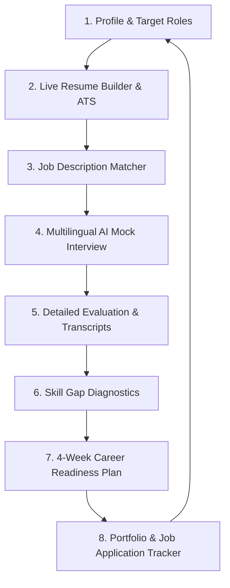

# CareerAI Coach — AI-Powered Resume & Multilingual Interview Platform

<div align="center">


**"Build Your Resume. Practice Your Interview. Build Your Career."**  
*Alternative Tagline:* *"From Student Profile to Job Ready — Powered by AI."*

[Features](#-core-features--innovations) • [Workflow](#-the-career-readiness-workflow) • [Tech Stack](#-technology-stack) • [Getting Started](#-quick-start) • [Viva & Demo Guide](#-college-project--viva-presentation-guide)

</div>

---

## 📌 Project Overview

**CareerAI Coach** is a modern, production-grade AI career coaching web application built specifically for college students, final-year engineering undergraduates, fresh graduates, and early-career job seekers.

Rather than being a static resume checker or a generic chatbot, CareerAI Coach unites all critical stages of campus placement and off-campus recruitment into a continuous **Career Readiness Cycle**:



---

## 🌟 Core Features & Innovations

### 1. 📝 Split-Screen Live AI Resume Builder
- **Interactive Two-Column Architecture:** Edit personal info, education, experience, projects, skills, and certifications on the left, with an instant **live document preview** updating in real time on the right.
- **7 Professional Templates:** Switch seamlessly between *Modern*, *Professional*, *Minimal*, *ATS-Friendly*, *Technical*, *Student*, and *Creative*.
- **Live Real-Time ATS Score Meter:** The ATS readiness algorithm recalculates keyword coverage and formatting taxonomy with every keystroke (e.g., `84%` → `88%` → `91%`).
- **AI Bullet Enhancement (Google XYZ Formula):** Rewrites rough bullet points using *"Accomplished [X] as measured by [Y], by doing [Z]"*.
- **1-Click Role-Specific Resume Versions:** Generates role-tailored resumes (e.g. *Software Developer Resume*, *Python Developer Resume*) without fabricating unverified information.
- **Clean Print & PDF Export:** Custom `@media print` CSS removes application bars and borders for clean, single-page PDF generation.

---

### 2. 🌐 Multilingual AI Mock Interview Room
- **10 Indian Regional Languages Supported:**
  - 🇬🇧 **English**
  - 🇮🇳 **தமிழ் (Tamil)**
  - 🇮🇳 **हिन्दी (Hindi)**
  - 🇮🇳 **తెలుగు (Telugu)**
  - 🇮🇳 **മലയാളം (Malayalam)**
  - 🇮🇳 **ಕನ್ನಡ (Kannada)**
  - 🇮🇳 **বাংলা (Bengali)**
  - 🇮🇳 **मराठी (Marathi)**
  - 🇮🇳 **ગુજરાતી (Gujarati)**
  - 🇮🇳 **ਪੰਜਾਬੀ (Punjabi)**
- **Independent 4-Way Language Matrix:** Configure separate languages for:
  - *Question Language*
  - *Question Explanation Language*
  - *Candidate Answer Language*
  - *Feedback & Evaluation Language*
- **"Explain Question" (Concept Clarifier):** Clarifies technical concepts (e.g., *Polymorphism*, *Database Indexing*, *REST Idempotency*) in your native regional tongue **without spoiling or giving away the ideal answer**.
- **English Translation Toggle:** View English translations side-by-side with regional questions.
- **Voice Capabilities:** Text-to-Speech audio playback using the Web Speech API and Speech-to-Text microphone recording with graceful text fallback.
- **Adaptive AI Questioning:** Strong answers trigger deeper architectural follow-ups; weaker answers prompt foundational clarification questions.

---

### 3. 📊 Interview Evaluation & Performance Report
- **Multi-Dimensional Metrics:** Evaluates *Technical Knowledge*, *Communication Clarity*, *Answer Relevance*, *Problem Solving*, *Answer Structure*, and *Confidence Indicators*.
- **Actionable Feedback Cards:** Highlighting *What You Did Well*, *What You Can Improve*, and *Recommended Practice*.
- **STAR Method Coaching:** Guidance for structuring behavioral responses (Situation, Task, Action, Result).
- **Interactive Full Transcript:** Complete question-by-question review with candidate responses, playback, and AI feedback.

---

### 4. 📅 4-Week Career Readiness Plan
- **28 Daily Guided Tasks (7 Days × 4 Weeks):**
  - **Week 1:** *Resume & Career Foundation* (100% completed)
  - **Week 2:** *Technical Skill Development* (In Progress)
  - **Week 3:** *Interview Preparation & Multilingual Drills*
  - **Week 4:** *Final Preparation, Live Applications & Mastery*
- **Interactive Habit System:** Checkboxes update weekly progress %, overall roadmap %, completed study hours, and active learning streaks (🔥 5+ days).
- **Interactive 28-Day Calendar:** Visual day states for *Completed*, *Today*, *Upcoming*, and *Missed* with rescheduling capabilities.
- **Adaptive Daily Goals:** Rebalances future tasks based on poor interview scores or identified skill gaps.
- **Time Management Adaptation:** Adjust daily study commitments (30m, 1h, 1.5h, 2h/day).
- **Before vs After Career Report:** Benchmarks progress from Week 1 baseline to Week 4 readiness.

---

### 5. 🎯 Multi-Role Profiles & Dynamic Role Switcher
- **Up to 5 Target Roles:** Searchable multi-select system supporting *Software Developer*, *Python Developer*, *Full Stack Developer*, *Data Analyst*, *AI/ML Engineer*, *Cloud Engineer*, and *Custom Roles*.
- **Global Role Switcher:** Dropdown in the top navigation instantly realigns ATS diagnostics, mock interview questions, skill gaps, and learning roadmaps across selected roles.

---

### 6. 🔍 ATS Optimizer & Live Job Description Matcher
- **Keyword Breakdown:** Visual comparison of *Matched Core Keywords* vs *Potentially Missing / Less Evident Keywords*.
- **Paste Job Description Matcher:** Paste any live job posting (Zoho, Thoughtworks, TCS, Amazon) to calculate match %, extract required skills, and receive resume tailoring tips.

---

### 7. 🤖 Context-Aware Floating AI Career Assistant
- **Floating AI Coach:** Conversational assistant with full visibility into the candidate's active role, resume score, assessed skill gaps, and daily roadmap.
- **Multilingual Chat:** Ask questions in Tamil (`எனக்கு Python interview-க்கு எப்படி prepare ஆக வேண்டும்?`), Hindi, or English.
- **Quick Prompt Chips:** One-click shortcuts for high-frequency questions.

---

### 8. 💼 Portfolio Generator & Job Application Tracker
- **Personal Developer Portfolio Generator:** 1-click live preview across 4 templates (*Developer*, *Modern*, *Minimal*, *Creative*) with a **Download Standalone HTML** export.
- **Job Application Pipeline CRM:** Tracks applications across *Saved*, *Applied*, *Assessment*, *Interview*, *Offer*, and *Rejected* with linked resume versions.
- **Smart Project Builder:** Structured wizard converting project ideas into problem-solution statements with Google XYZ bullets.
- **Verified Achievements:** Showcase hackathons, contest badges (LeetCode Knight), and technical awards.

---

### 9. 🛡️ Privacy & Local Data Governance
- **Client-Side Safe:** All user data, customized resumes, and transcripts are stored securely in browser `localStorage`.
- **Zero Fabrication:** The AI only restructures verified user details and never fabricates false degrees or fake experiences.
- **One-Click Reset:** Reset to Arun Kumar's demo baseline anytime with one click.

---

## 🛠️ Technology Stack

| Layer | Technology | Details |
|---|---|---|
| **Frontend Framework** | React 19 + TypeScript | Modular functional components with hooks |
| **Build Tool & Bundler** | Vite 8 | Fast HMR and lightweight production bundle |
| **Styling & Design System** | Vanilla CSS Tokens | Sleek dark AI SaaS theme, glassmorphism, responsive grids, and print stylesheet |
| **Typography** | Google Fonts | *Plus Jakarta Sans* & *JetBrains Mono* |
| **Icons** | Lucide React | Clean, modern vector UI iconography |
| **Voice & Speech** | Web Speech API | SpeechSynthesis (TTS) & WebkitSpeechRecognition (STT) |
| **Celebrations** | canvas-confetti | Milestone completions and streak achievements |
| **Storage & State** | Client Storage (`localStorage`) | Persistent client state with demo data fallback |

---

## 📁 Codebase Directory Structure

```
c:\Users\vedika\ai career coach\
├── src/
│   ├── types/
│   │   └── index.ts                 # TypeScript interfaces (User, Resume, Interview, Plan, etc.)
│   ├── data/
│   │   └── mockData.ts              # Pre-configured demo user (Arun Kumar) & 28-day roadmap
│   ├── services/
│   │   ├── aiService.ts             # Modular AI service (ATS scorer, multilingual interview, chat)
│   │   └── storageService.ts        # Client-side persistence (localStorage) & demo state
│   ├── components/
│   │   ├── Navbar.tsx               # Top header with role switcher, search & language menu
│   │   ├── Sidebar.tsx              # Responsive navigation with learning streak counter
│   │   ├── LandingPage.tsx          # High-conversion SaaS landing page & pipeline diagram
│   │   ├── Dashboard.tsx            # Multi-dimensional readiness scorecards & today's goal
│   │   ├── ResumeBuilder.tsx        # Split-screen live resume builder with 7 templates
│   │   ├── ResumeAnalyzer.tsx       # Resume upload diagnostic & category scoring
│   │   ├── ATSOptimizer.tsx         # ATS keyword analyzer & live job description matcher
│   │   ├── MockInterview.tsx        # Multilingual mock interview with voice & explain question
│   │   ├── InterviewEvaluation.tsx  # Detailed report card, STAR method & transcript
│   │   ├── InterviewHistory.tsx     # Session history & past evaluations
│   │   ├── InterviewPractice.tsx    # Standalone confidence & speech drills
│   │   ├── SkillGapAnalyzer.tsx     # Competency benchmarks & study roadmaps
│   │   ├── LearningPlan.tsx         # Dedicated 4-Week Career Readiness Plan & calendar
│   │   ├── PortfolioBuilder.tsx     # Personal developer portfolio generator & HTML export
│   │   ├── ProjectsManager.tsx      # Smart technical project builder wizard
│   │   ├── AchievementsManager.tsx  # Verified hackathon & award builder
│   │   ├── JobApplicationTracker.tsx# Job application pipeline CRM
│   │   ├── AICareerAssistant.tsx    # Floating conversational assistant
│   │   ├── RoleProfileManager.tsx   # Multi-role selector & comparative profiles
│   │   ├── LanguageSettings.tsx     # Multilingual matrix preferences
│   │   ├── PrivacySettings.tsx      # Privacy dashboard & local data controls
│   │   └── ProfileEditModal.tsx     # Profile and credential editor
│   ├── App.tsx                      # Main application coordinator
│   ├── main.tsx                     # React DOM entry point
│   └── index.css                    # Design system tokens, utilities & print styles
├── index.html                       # HTML5 metadata & Plus Jakarta Sans Google Fonts
├── vite.config.ts                   # Vite configuration
├── tsconfig.json                    # TypeScript compiler configuration
└── package.json                     # Dependencies & scripts
```

---

## ⚡ Quick Start

### Prerequisites
- **Node.js** (v18.x, v20.x, or v24.x recommended)
- **npm** (v9.x or later)

### Installation & Launch

1. **Clone or open the project folder:**
   ```bash
   cd "c:\Users\vedika\ai career coach"
   ```

2. **Install dependencies:**
   ```bash
   npm install
   ```

3. **Start the local development server:**
   ```bash
   npm run dev
   ```

4. **Open your browser and navigate to:**
   ```
   http://localhost:5173/
   ```

5. **Build for production (testing bundle correctness):**
   ```bash
   npm run build
   ```

---

## 👤 Pre-Configured Demo Profile

To demonstrate the application immediately without tedious data entry, the app comes pre-loaded with **Arun Kumar**:
- **Name:** Arun Kumar
- **College:** National Institute of Engineering & Technology
- **Degree:** B.E. in Computer Science & Engineering (2026)
- **Target Roles:** Software Developer, Python Developer, Full Stack Developer
- **Technical Skills:** Python, Java, SQL, HTML5/CSS3, JavaScript, Git, Data Structures, OOP
- **Featured Projects:**
  1. *QR-Based Automated Attendance System* (Python Flask, OpenCV, SQLite)
  2. *CareerAI: Resume & Interview Coach* (React, TypeScript, Web Speech API)
- **Certifications:** Python for Everybody (Univ. of Michigan), AWS Cloud Fundamentals
- **Achievements:** Finalist - Smart Campus Hackathon 2024, LeetCode Knight (250+ solved)
- **Preferred Languages:** English & தமிழ் (Tamil)

---


---

## 📄 License & Attribution

Developed for educational demonstration, hackathon presentations, and career readiness enhancement.  
© 2026 **CareerAI Coach**. All rights reserved.
