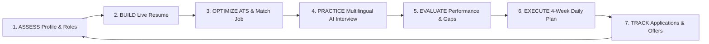

# CareerAI Coach — AI-Powered Resume, Interview & Career Readiness Platform

> **Tagline:** *"Build Your Resume. Practice Your Interview. Build Your Career."*  
> **Platform URL:** `http://localhost:5173/`

---

## 🚀 Executive Summary & Architecture Overview

**CareerAI Coach** is a modern, production-grade AI career platform tailored for college students, final-year undergraduates, and early-career job seekers. Rather than acting as a static resume checker, the platform implements a continuous **Career Readiness Cycle**:



---

## 🌟 Key Innovations & Feature Tour

### 1. 📝 Split-Screen Live AI Resume Builder
- **Real-Time Interactive Editor:** Split-screen layout featuring a form editor on the left and a live document preview on the right. Every keystroke reflects instantly.
- **7 Professional Templates:** *Modern*, *Professional*, *Minimal*, *ATS-Friendly*, *Technical*, *Student*, and *Creative*.
- **Live ATS Meter:** Algorithmic indicator recalculates keyword density and typography structure live (e.g., 84% → 88% → 91%).
- **AI Bullet Enhancement (Google XYZ Formula):** Automatically restructures bullet points using *"Accomplished [X] as measured by [Y], by doing [Z]"*.
- **1-Click Role-Specific Resumes:** Generates tailored resume versions for different target roles (e.g. *Arun_SoftwareDeveloper.pdf*, *Arun_PythonDeveloper.pdf*).
- **Print & PDF Export:** Clean `@media print` styling removes UI chrome to produce pixel-perfect single-page resumes.

### 2. 🌐 Multilingual AI Mock Interview Room
- **10 Indian Regional Languages Supported:** English, தமிழ் (Tamil), हिन्दी (Hindi), తెలుగు (Telugu), മലയാളം (Malayalam), ಕನ್ನಡ (Kannada), বাংলা (Bengali), मराठी (Marathi), ગુજરાતી (Gujarati), and ਪੰਜਾਬੀ (Punjabi).
- **Independent Language Matrix:** Independent settings for:
  - *Question Language*
  - *Explanation Language*
  - *Answer Language*
  - *Feedback Language*
- **"Explain Question" (Concept Clarifier):** Explains technical terms (e.g. Polymorphism, REST idempotency, SQL indexing) in regional dialect **without spoiling or giving away the answer**.
- **Voice Capabilities:** Web Speech Synthesis for audio playback and Web Speech Recognition for voice input with graceful text fallback.
- **Live Adaptive Feedback:** Immediate evaluation upon submitting each answer, followed by adaptive follow-ups.

### 3. 📅 4-Week Career Readiness Plan
- **28 Daily Guided Tasks (7 Tasks / Week):**
  - **Week 1:** *Resume & Career Foundation*
  - **Week 2:** *Technical Skill Development*
  - **Week 3:** *Interview Preparation & Multilingual Drills*
  - **Week 4:** *Final Preparation, Live Applications & Mastery*
- **Interactive Habit System:** Checkboxes update weekly progress %, overall progress %, learning hours, and active learning streaks (🔥 5+ days).
- **Study Calendar View:** 28-day grid with visual states for *Completed*, *Today*, *Upcoming*, and *Missed* tasks.
- **Time Management Adaptation:** Adapts task workloads based on user study commitments (30m, 1h, 1.5h, 2h/day).
- **Before vs After Progression Report:** Quantifies resume point gains, mock score increases, and resolved skill gaps.

### 4. 🎯 Multi-Role Career Profiles & Job Matcher
- **Up to 5 Target Career Roles:** Searchable multi-select system covering *Software Developer*, *Python Developer*, *Full Stack Developer*, *Data Analyst*, *AI/ML Engineer*, *Cloud Engineer*, and *Custom Roles*.
- **Active Role Switcher:** Navbar dropdown realigns ATS diagnostics, interview questions, and learning roadmaps on the fly.
- **Paste Job Description Matcher:** Pasting real job descriptions (e.g. Zoho, Thoughtworks, TCS) computes match %, highlights matching vs missing skills, and suggests exact phrasing.

### 5. 🤖 Context-Aware AI Career Assistant
- **Floating AI Coach:** Conversational assistant with full visibility into Arun Kumar's active role, resume ATS metrics, assessed skill gaps, and daily roadmap.
- **Regional Dialect Support:** Responds in Tamil, Hindi, or English based on user query language.

### 6. 💼 Portfolio Generator & Application Tracker
- **1-Click Portfolio Builder:** Live preview across 4 templates (*Developer*, *Modern*, *Minimal*, *Creative*) with exportable standalone HTML download.
- **Job Application Pipeline CRM:** Tracks opportunities across *Saved*, *Applied*, *Assessment*, *Interview*, *Offer*, and *Rejected* with linked resume versions.

---

## 🛠️ Technology Stack & Codebase Structure

```
c:\Users\vedika\ai career coach\
├── src/
│   ├── types/
│   │   └── index.ts                 # Comprehensive TypeScript interfaces & types
│   ├── data/
│   │   └── mockData.ts              # Pre-configured demo user (Arun Kumar) & 28-day roadmap
│   ├── services/
│   │   ├── aiService.ts             # Modular AI service (ATS scorer, multilingual interview, chat)
│   │   └── storageService.ts        # Client-side persistence (localStorage) & demo state
│   ├── components/
│   │   ├── Navbar.tsx               # Top header with role switcher, search & language menu
│   │   ├── Sidebar.tsx              # Responsive navigation with learning streak counter
│   │   ├── LandingPage.tsx          # High-conversion SaaS landing page & pipeline diagram
│   │   ├── Dashboard.tsx            # Multi-dimensional readiness scorecards & today's goal
│   │   ├── ResumeBuilder.tsx        # Split-screen live resume builder with 7 templates
│   │   ├── ResumeAnalyzer.tsx       # Resume upload diagnostic & category scoring
│   │   ├── ATSOptimizer.tsx         # ATS keyword analyzer & live job description matcher
│   │   ├── MockInterview.tsx        # Multilingual mock interview with voice & explain question
│   │   ├── InterviewEvaluation.tsx  # Detailed report card, STAR method & transcript
│   │   ├── InterviewHistory.tsx     # Session history & past evaluations
│   │   ├── InterviewPractice.tsx    # Standalone confidence & speech drills
│   │   ├── SkillGapAnalyzer.tsx     # Competency benchmarks & study plans
│   │   ├── LearningPlan.tsx         # Dedicated 4-Week Career Readiness Plan & calendar
│   │   ├── PortfolioBuilder.tsx     # Personal developer portfolio generator & HTML export
│   │   ├── ProjectsManager.tsx      # Smart technical project builder wizard
│   │   ├── AchievementsManager.tsx  # Verified hackathon & award builder
│   │   ├── JobApplicationTracker.tsx# Job application pipeline CRM
│   │   ├── AICareerAssistant.tsx    # Floating conversational assistant
│   │   ├── RoleProfileManager.tsx   # Multi-role selector & comparative profiles
│   │   ├── LanguageSettings.tsx     # Multilingual matrix preferences
│   │   ├── PrivacySettings.tsx      # Privacy dashboard & local data controls
│   │   └── ProfileEditModal.tsx     # Profile and credential editor
│   ├── App.tsx                      # Top-level application coordinator
│   ├── main.tsx                     # Entry point
│   └── index.css                    # Design system, CSS variables & print styles
├── index.html                       # HTML5 metadata & Plus Jakarta Sans Google Fonts
├── vite.config.ts                   # Vite configuration
└── package.json                     # Dependencies & scripts
```

---

## 🎓 Demo & Viva Presentation Talking Points

1. **Problem Statement:** College students often use fragmented tools: a standalone resume builder, an unrelated mock interview app, and scattered YouTube playlists, leaving them without structured guidance or multilingual clarity.
2. **Unified Solution:** CareerAI Coach creates an integrated feedback loop: Resume diagnosis leads to skill gaps, which configure the 4-week learning plan, which feeds role-tailored mock interview questions in their regional language, building measurable career readiness.
3. **Multilingual Inclusivity:** Demonstrates that students can practice in Indian regional languages (like Tamil or Hindi) with concept clarifiers while still learning professional English terminology required for corporate technical panels.
